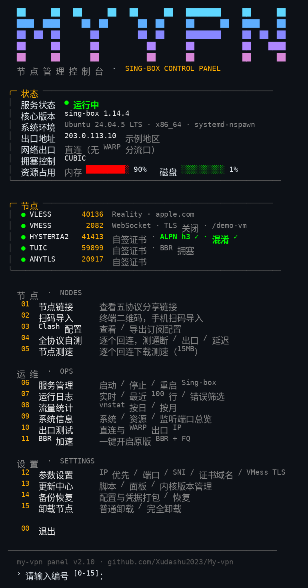

# My-vpn —— 个人纯净版 sing-box 一键安装脚本

只做三件事：**装内核、写配置、起服务。**


## 快速开始

```bash
curl -fsSL -o my-vpn-install.sh https://raw.githubusercontent.com/Xudashu2023/My-vpn/main/my-vpn-install.sh
sudo bash my-vpn-install.sh install
```

或克隆仓库后本地运行 `sudo bash my-vpn-install.sh install`。

## 功能

- 五协议：VLESS-REALITY / VMess-WS / AnyTLS / Hysteria2 / TUIC；五协议入站均开嗅探（sniff + sniff_override_destination）
- VMess TLS 开关：默认纯 WS（老链接不变）；用 `VMESS_TLS=1` 重跑 install 可切为 WS+TLS（自签证书，客户端链接与 Clash 配置同步带 tls/sni），面板菜单 12 也可改
- 端口：首次安装在 20000-60000 随机生成、互不重复且避开已占用端口，写入 `/etc/my-vpn/ports.env` 持久化；重装自动复用不变更。已有旧版 config.json 的机器保持原端口。可用环境变量 `PORT_*` 或面板指定
- 每个协议独立生成 UUID/密码（不再共用一个凭据）
- sing-box 内核锁定 1.14.4（不追 latest），下载后按 GitHub 官方发布摘要做 SHA256 校验，取不到摘要直接中止
- 配置写入前先 `sing-box check` 校验，并备份旧配置；重跑 install 不重置已有凭据；凭据文件缺项时直接报错停下（不生成坏配置）
- 装完当场核验：服务未进 active 直接报错并打印日志，五协议端口逐个查监听，未监听的只警告不谎报完成
- 安装产物集中：二进制 `/usr/local/bin/sing-box`、配置目录 `/etc/my-vpn`、systemd 服务 `my-vpn`
- 凭据在 `/etc/my-vpn/credentials.env`（600），分享链接与 Clash 配置在 `/etc/my-vpn/client/`（600）

子命令：`install` / `uninstall`（普通卸载）/ `purge`（完全卸载）/ `print-config`（免 root 预览配置）/ `show-links` / `status`

## 一键安装（本体 + 面板）

```bash
curl -fsSL https://raw.githubusercontent.com/Xudashu2023/My-vpn/main/install.sh -o /tmp/my-vpn-all.sh && sudo bash /tmp/my-vpn-all.sh
```

一条命令装齐本体与面板，装完输 `mv` 进面板（`my-vpn` 也一样）。出站经 WARP/透明代理的机器需带上真实 IP（否则自动探测到的是代理出口）：`sudo SERVER_IP=x.x.x.x bash /tmp/my-vpn-all.sh`。

### 支持环境（任意新服务器直接装）

- 架构：x86_64 / arm64
- 系统：带 systemd 的 Debian 11+、Ubuntu 20.04+、RHEL 8+、Rocky、AlmaLinux、CentOS Stream
- 依赖（curl/tar/openssl/python3/ss/free 等）按 apt / dnf / yum 自动补齐
- 本机防火墙：UFW 或 firewalld 自动放行五协议端口；**云厂商安全组仍需在控制台手动放行**（安装日志会打印随机端口号）
- 不支持：Alpine/OpenRC、无 systemd 的容器环境（脚本会明确报错说明）

## 许可

MIT，见 [LICENSE](LICENSE)。可自由使用、修改与分发。
本脚本与 sing-box 官方（SagerNet）无隶属关系；
在本机以 root 运行任何一键脚本前，请先通读脚本内容。

## 注意

- **改名说明：本项目原名 mybox，现已全量改名为 My-vpn。** 命令、服务、配置目录、节点名全部换了（`my-vpn` 命令、`my-vpn` 服务、`/etc/my-vpn`），旧版 mybox 安装与新版不兼容，不能直接升级覆盖；旧机器须先用旧版 purge 卸载，再按新命令重装，节点链接会全部变。
- **mv 快捷入口说明：** `mv` 本身是系统移动命令，不能直接拿面板覆盖，否则面板自己的更新和系统里调 `mv` 的地方都会坏。一键安装装的是一个包装：不带参数输 `mv` 进面板，带参数（如 `mv 文件1 文件2`）仍是系统 mv；完全卸载时会清理包装，已有非本项目文件会先备份恢复。
- 自签证书 CN 默认 www.bing.com、REALITY SNI 默认 apple.com，均可用环境变量改
- 防火墙只处理 UFW（启用时放行五协议端口）；云厂商安全组需自行放行
- 服务端配置按 sing-box 1.14 格式生成（1.14 已移除 VMess 服务端 alter_id 字段）

## 面板（可选附加件）

`my-vpn-panel.sh` 是独立的交互面板，装上后在服务器输 `mv` 调出（`my-vpn` 也一样）：



*上图为面板主界面示例：IP、端口、资源占用均为演示数据，实际以你服务器上的面板为准。*
深色高级感设计（MY VPN 渐变块字主标、卡片式状态/节点区、
两位数编号留白菜单、香槟金点缀），
菜单含查看链接、终端二维码导入、全协议本机自测、服务管理、日志、
流量统计（按日 / 按月两张表）、系统信息（含五协议监听端口总览）、修改 IP/端口/SNI、一键开启内核原版 BBR+FQ 加速、
节点卡上每个协议带实时监听圆点（绿=在监听，红=未监听，不再只读配置）、
Sing-box 内核版本管理（更新到最新 / 指定版本切换 / 官方版本摘要校验 / 失败自动回滚）、
节点测速（逐协议本机回连下载 15MB 测速）、从 GitHub 更新脚本与面板、备份/恢复、两档卸载（普通卸载 / 完全卸载 purge：连面板、脚本、备份、BBR 配置一并清除）。

```bash
curl -fsSL -o /usr/local/bin/my-vpn https://raw.githubusercontent.com/Xudashu2023/My-vpn/main/my-vpn-panel.sh
chmod 755 /usr/local/bin/my-vpn
my-vpn
```

核心安装脚本本身依旧无菜单、无快捷命令；面板只是它的可选外壳，
所有装/改/卸都转调安装脚本的子命令，配置与凭据只有一份。
个人开发测试，仅为测试所有。
